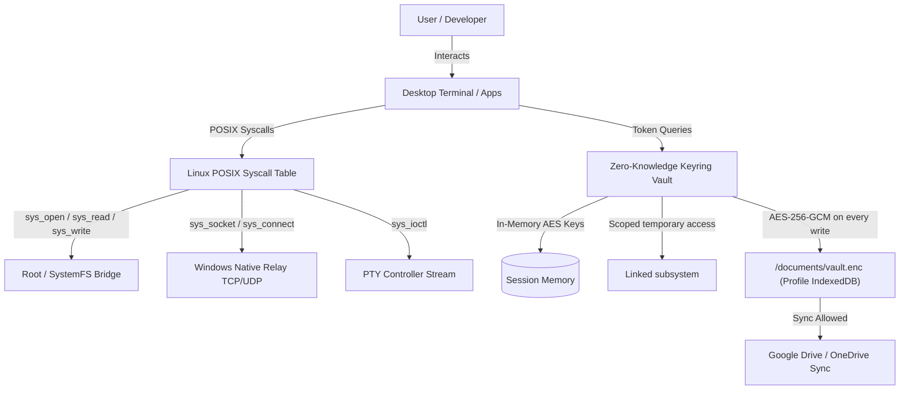

# PortfoliOS System Architecture

Shared ownership and loading decisions live in [the Orchestration architecture standard](https://github.com/Bl4ut0/PortfoliOS-Orchestration/blob/main/docs/core/ARCHITECTURE.md).

This document describes the modular implementation of PortfoliOS. The project is split into distinct layers separating data (portfolio content), core services, modular applications, local AI processing, and visual presentation shells with a strict **Desktop-First (Desktop 1st, Mobile 2nd / Last)** platform strategy.

---

## 1. Directory Structure

```text
PortfoliOS/
├── core/                         # Core system services
│   ├── credential-vault.js       # Encrypted account records, subsystem bindings and revocable access
│   ├── runtime-bridge.js         # POSIX Root / VFS bridge, PTY controller, process harness, ZK vault, git helper
│   ├── cloud-auth.js             # Unified cloud auth driver (Google Drive & OneDrive)
│   ├── cloud-sync.js             # Unified cloud sync driver
│   ├── event-bus.js              # EventBus pub/sub nervous system
│   ├── state.js                  # Global ES6 Proxy state store
│   ├── filesystem.js             # IndexedDB Virtual File System (SystemFS) with root /
│   ├── gdrive-sync.js            # Google Drive sync provider (vault.enc sync, plain /etc blocked)
│   ├── security-service.js       # SecurityKernel local policy scanner and quarantine
│   ├── local-ai.js               # Browser-local WebGPU/WebLLM inference
│   ├── preferences.js            # Profile-scoped preferences
│   ├── app-framework.js          # Modular app window presets and lifecycle hooks
│   └── app-loader.js             # Dynamic on-demand script/style loader
├── data/                         # Portfolio content data arrays (systems, bookmarks, config, users)
├── desktop/                      # Desktop experience modules (Desktop 1st priority)
│   ├── workspace.html            # Main desktop DOM, Start menu, taskbar, ZK vault modal
│   ├── shell.js                  # Desktop shell orchestrator and window manager
│   ├── terminal.js               # Linux terminal emulator and POSIX CLI runner
│   ├── settings.js               # Desktop Settings app with ZK Vault and Cloud Sync controls
│   └── brain-helper.js           # Desktop AI assistant panel
├── mobile/                       # Mobile experience modules (Mobile 2nd / Last priority)
├── quick/                        # Quick review view (shell)
├── apps/                         # Modular applications (office, iptv, webamp, files, doomsource, etc.)
├── services/                     # Backend and native proxy services
│   ├── native-relay/             # Windows Native Messaging Host (.msi) & browser extension
│   └── ut99-relay/               # Node.js WebSocket-to-UDP proxy relay server
├── styles/                       # Segmented style sheets (styles-v1.css, components.css, tokens.css)
└── index.html                    # Staged entry point HTML container
```

---

## 2. Platform Strategy & Priority

> **Desktop 1st, Mobile 2nd (Mobile Last)**
>
> All architecture decisions and milestones follow an explicit **Desktop-First** model. The desktop shell is the primary platform hosting the windowed workspace, terminal CLI runner, Root `/` POSIX filesystem, Zero-Knowledge Keyring Vault, and WASM application suites. The mobile shell is a lightweight companion that follows desktop milestones; mobile touch adaptations and mobile parity passes are scheduled last.

---

## 3. Key Components

### A. Core Layers (`/core`)
- **[credential-vault.js](core/credential-vault.js)**: OS-owned encrypted credential broker; [storage, bridge and lifecycle contract](docs/VAULT_AUTH.md).
- **[runtime-bridge.js](core/runtime-bridge.js)**: Secondary connector adapter integrating the Root `/` POSIX VFS bridge, PTY controller, Linux process harness, Zero-Knowledge Keyring Vault, and Git credential helper (`git-credential-portfolios`).
- **[cloud-auth.js](core/cloud-auth.js)** & **[cloud-sync.js](core/cloud-sync.js)**: Unified cloud authentication and sync drivers supporting Google Drive and Microsoft OneDrive with client-side encrypted envelope synchronization.
- **[event-bus.js](core/event-bus.js)**: System EventBus avoiding direct component coupling via events (`app:opened`, `app:closed`, `fs:changed`, `portfolios:vault-status-changed`).
- **[state.js](core/state.js)**: Global state object (`window.state`) wrapped in an ES6 Proxy with automatic EventBus trigger emission.
- **[filesystem.js](core/filesystem.js)**: Virtual File System (`SystemFS`) backed by IndexedDB with root `/` hierarchy (`/`, `/home`, `/usr/local/bin`, `/etc`, `/tmp`, `/documents`).
- **[gdrive-sync.js](core/gdrive-sync.js)**: Google Drive sync provider permitting `/documents/vault.enc` and blocking unencrypted `/etc` and dotfiles.
- **[security-service.js](core/security-service.js)**: SecurityKernel local policy scanner inspecting user imports and cloud restores before workspace entry.
- **[app-framework.js](core/app-framework.js)**: Modular app window presets, lifecycle hooks, iframe messaging, and teardown.
- **[app-loader.js](core/app-loader.js)**: Lazily loads modular app scripts and styles on demand.
- **[local-ai.js](core/local-ai.js)**: Manages browser-local WebGPU/WebLLM models and fallback routing.
- **[preferences.js](core/preferences.js)**: Profile-scoped user preferences and volume state propagation.

### B. Desktop Interface (`/desktop`) — Priority 1
- **[workspace.html](desktop/workspace.html)**: Complete desktop markup including window layers, Start menu, taskbar, system tray, and the **Zero-Knowledge Vault Modal** (`#vault-modal`) with **Unlock**, **Setup**, and **Purge & Reset** views.
- **[shell.js](desktop/shell.js)**: Orchestrates window management, focus ordering, taskbar mapping, and desktop icons.
- **[terminal.js](desktop/terminal.js)**: POSIX terminal shell with built-in CLI executors (`vault`, `codex`, `agy`, `claude`, `xai`, `apt`, `npm`, `curl`, `wget`, `sh`).
- **[settings.js](desktop/settings.js)**: System Settings app with dedicated Zero-Knowledge Keyring Vault actions (Unlock, Setup, Export, Lock, Purge) and cloud sync configuration.

### C. Services & Native Relay (`/services`)
- **[native-relay](services/native-relay)**: Windows Native Messaging Host installer (`PortfoliOS-NativeRelay.msi`) and browser extension unlocking raw duplex TCP and UDP sockets for guest runtimes.
- **[ut99-relay](services/ut99-relay)**: Standalone Node.js WebSocket-to-UDP proxy relay server for web multiplayer sessions.

---

## 4. Communication Architecture



- **POSIX Syscall Mapping**: User-space translation layer maps Linux binary syscalls directly to browser secondary connectors.
- **Encrypted keyring**: Passphrase-derived AES key and plaintext records stay in memory while unlocked. Only ciphertext persists. Lock/profile changes revoke leases; saved bindings survive reload. Real native process/auth delivery remains open; manual Git helper output never includes secrets.
- **Event-Driven Reactivity**: SystemFS file changes emit `fs:changed`, and vault transitions emit `portfolios:vault-status-changed`, keeping the UI in sync without polling.
